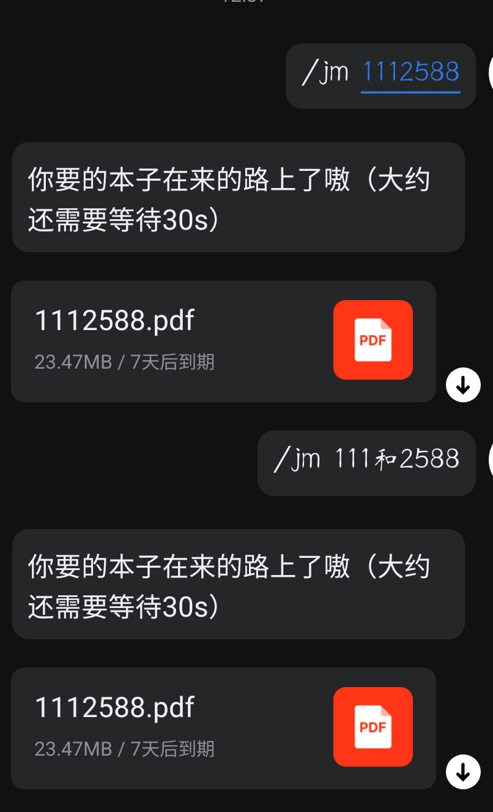

# jmcomicsget

~~封号模拟器~~ AstrBot 插件

A template plugin for AstrBot

本插件主要依赖于 jmcomic 和 astrbot

jmcomic 包详细使用请查阅：https://github.com/hect0x7/JMComic-Crawler-Python

安装： 1.在 astrbot 插件市场中直接安装 jmcomicsget

2.将本插件 clone 到"AstrBot\data\plugins"中

`git clone https://github.com/Ayachi2225/astrbot_plugin_jmcomicsget.git`

然后 astrbot 会自动下载依赖项，如果下载失败可以在终端中激活 uv 隔离的虚拟环境然后手动下载依赖`pip install requirements.txt`（注意在插件目录下），不会找和激活虚拟环境的自行问 ai

使用例：输入：/jm 本子编号 或 /jm 包含着本子编号的字符串

默认下载文件保存到插件目录的 pdfs 中，如需修改，请修改 option.yml 文件中 base_url 和 plugin 项 pdf_dir 中地址（修改后还要修改 main.py 中读取 pdf 文件位置）同时 option.yml 也可以有很多其他修改项，详情请参考上述 jmcomic 源项目

ps：目前本插件仅能借助 napcat 发送文件（lagrange 不行），且仅在 qq 个人号 windows napcat 上成功运行了。
